<p align="center">
  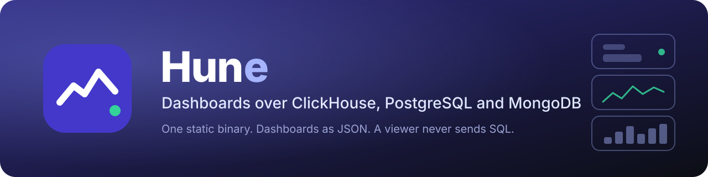
</p>

<p align="center">
  <a href="https://github.com/ProcurAuth/hune/actions/workflows/ci.yaml"></a>
  <a href="https://github.com/ProcurAuth/hune/releases/latest"></a>
  <a href="https://procurauth.github.io/hune/conformance.html"></a>
  <a href="#licence"></a>
  
  
  
</p>

<p align="center">
  <a href="https://procurauth.github.io/hune/"><b>Website</b></a> ·
  <a href="#documentation">Docs</a> ·
  <a href="https://procurauth.github.io/hune/access.html">Access</a> ·
  <a href="https://procurauth.github.io/hune/configuration.html">Configuration</a> ·
  <a href="SECURITY.md">Security</a> ·
  <a href="https://github.com/ProcurAuth/hune/releases/latest">Downloads</a>
</p>

# Hune

Hune is a dashboard server. It shows dashboards of tables, time series, stat panels and charts over ClickHouse, PostgreSQL and MongoDB. Each dashboard is a JSON document with an editor, a history of versions and a time picker. The command `import-grafana` reads dashboards that you export from Grafana.

It is for teams that keep their data in SQL and want one small server for dashboards. It has one static binary and one configuration file. A folder or a PostgreSQL database keeps the documents. **The server builds every query from the saved document, so a viewer never sends SQL.**

<p align="center">
  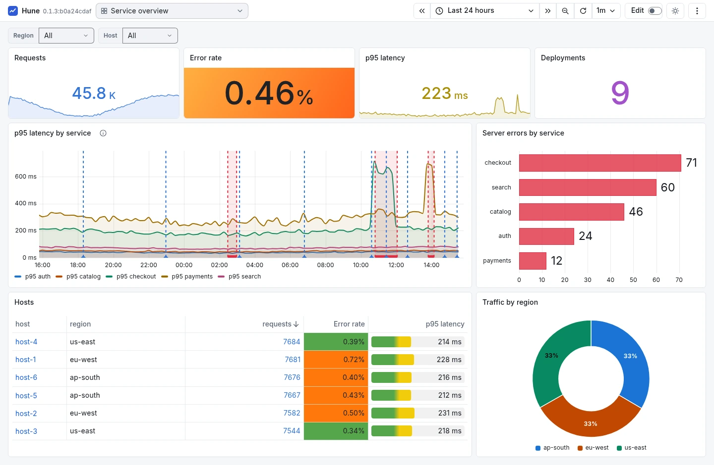
</p>

## How it works

Hune is one static binary. It has the page inside. The browser asks for a panel by id. Hune finds the saved query, puts the macros and the variable values in the text, checks it, applies the limits and asks the data source. In the mode `authzen`, an edge signs an identity token, and Hune asks a decision point (PDP) before each operation.

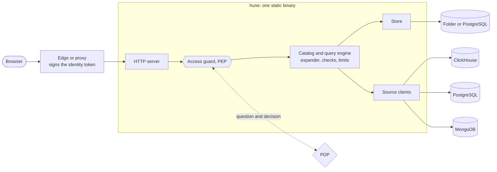

<p align="center">
  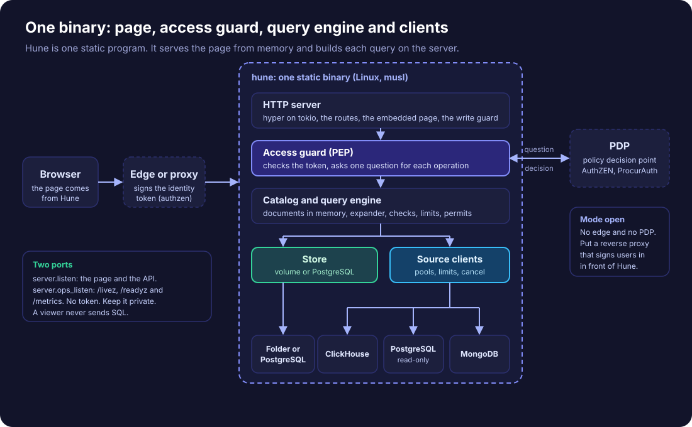
</p>

A document is JSON with a closed schema. The server writes it in one canonical form and keeps its history. A query goes through the same steps each time: the request, the saved text, the expander, the checks and limits, and the source.

<p align="center">
  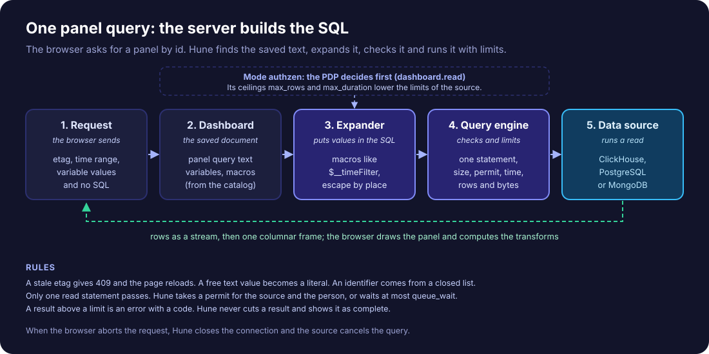
</p>

| Area | What Hune does |
| --- | --- |
| Data sources | ClickHouse, PostgreSQL and MongoDB. Each kind has a closed check of the query text, limits, a cancel and a probe. |
| Panels | Table, time series, stat, bar chart, pie chart, XY chart, bar gauge, gauge, text, state timeline, status history, heatmap, histogram, logs and map. |
| Variables | Query, custom, text box, interval, constant and ad hoc filters. A variable can repeat a panel or a row. Transformations and annotations are part of the format. |
| Editor | Forms for each panel type, a query editor with a syntax tree, a history of versions, a conflict screen and restore. |
| Stores | A folder of JSON files (a volume) or a PostgreSQL database. Commands copy, export, import and restore documents. |
| Grafana | The command `import-grafana` reads an export of Grafana dashboards. It writes a report, an acceptance file and an nginx map. |
| Access | The mode `authzen` checks an identity token and asks a PDP. The mode `open` needs a proxy that signs users in. |
| Configuration | One HCL file. A closed schema. A mistake stops the start. `print-config` shows each value and its source. |
| Operation | JSON logs, Prometheus metrics, audit lines and an OTLP exporter of traces. A second port serves the probes. |
| Page | Plain JavaScript, HTML and CSS. No framework, no build step and no request to another origin. Light and dark themes. |

## Example

A panel keeps its SQL in the document. The text uses macros and variables:

```sql
SELECT $__timeInterval(event_time) AS t, node, sum(weight) AS weight
FROM analytics.weights
WHERE $__timeFilter(event_time) AND node IN ($node) AND env = '$env'
GROUP BY t, node
ORDER BY t
```

The browser sends the time range, the width of the panel and the values `a1` and `b'2` for `node`. It sends no SQL. Hune escapes each value by its place in the text. ClickHouse gets this statement in the body of a request, from a read-only account:

```sql
SELECT toStartOfInterval(toDateTime(event_time), INTERVAL 20 second) AS t, node, sum(weight) AS weight
FROM analytics.weights
WHERE event_time >= toDateTime(1794211200) AND event_time <= toDateTime(1794232800) AND node IN ('a1','b\'2') AND env = 'prod'
GROUP BY t, node
ORDER BY t
```

Hune refuses a statement that is not one `SELECT` or `WITH`. The account of the source stays the real boundary of the data. [docs/03-api-query-sources.md](docs/03-api-query-sources.md) has the rules.

In the mode `authzen`, Hune is a PEP of [ProcurAuth](https://github.com/ProcurAuth/procurauth). The resource tree is service, folder, dashboard and source. A grant on a folder covers its dashboards.

<p align="center">
  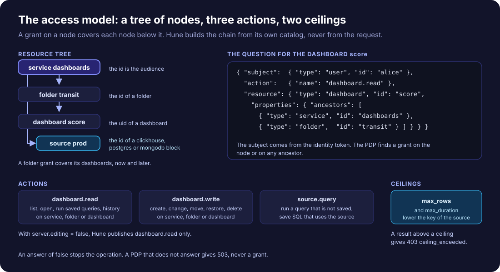
</p>

This `access` block makes Hune check the tokens of an edge and ask a PDP:

```hcl
access {
  mode = "authzen"

  identity {
    issuer           = "https://edge.example.com"
    audience         = "dashboards"
    public_keys_file = "/etc/hune/edge-jwks.json"
  }

  pdp {
    url        = "https://pdp.example.com:4182"
    token_file = "/etc/hune/pdp-token"
  }
}
```

The PDP answers `true` or `false`, with optional ceilings `max_rows` and `max_duration` that lower the limits of the source. An answer of `false` gives `403`. A PDP that does not answer gives `503`, never a grant. [docs/ACCESS.md](docs/ACCESS.md) has the rules.

## See it

| | |
| --- | --- |
| 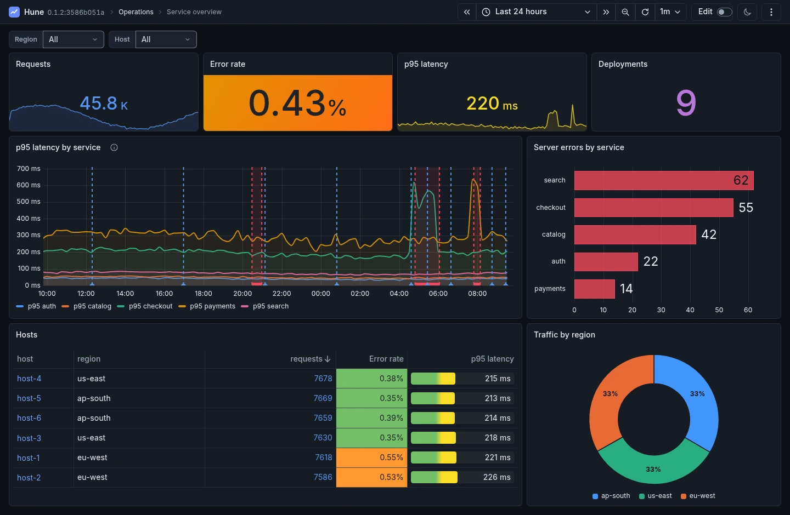 | 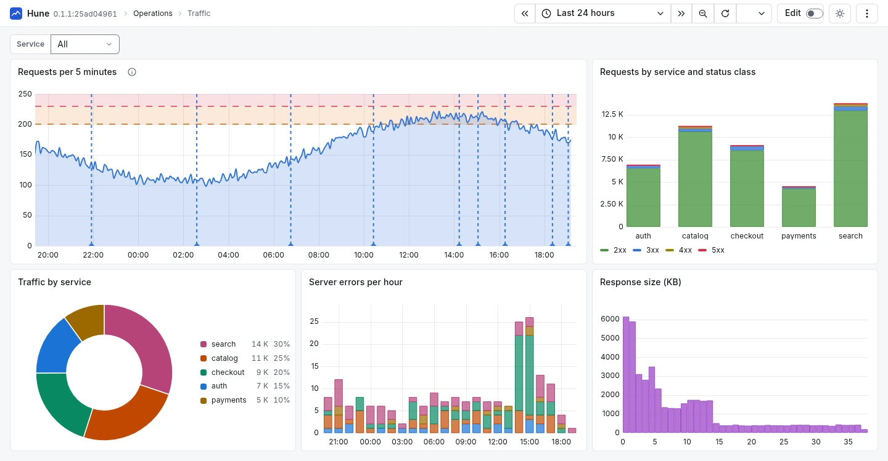 |
| The dark theme. The page has a light theme and a dark theme. | Time series with thresholds, bar charts and more. |
| 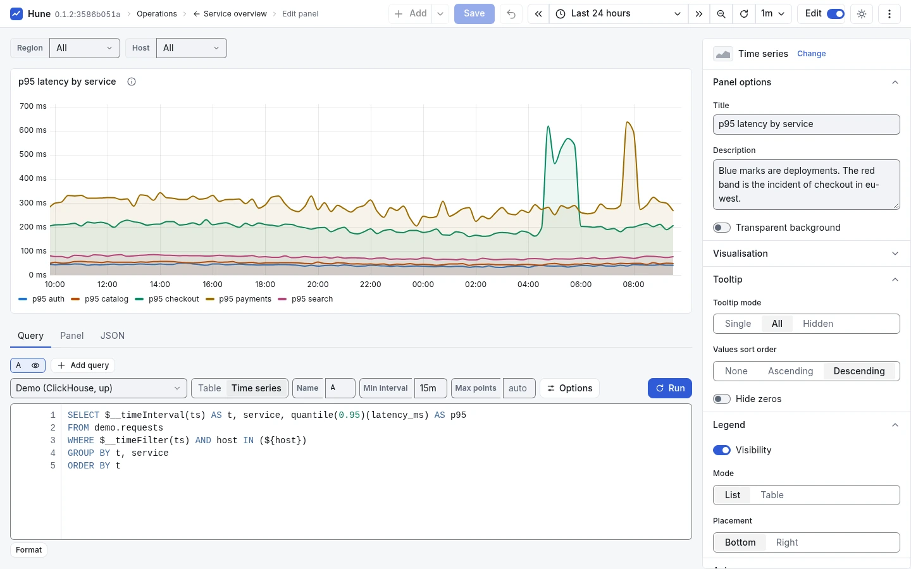 | 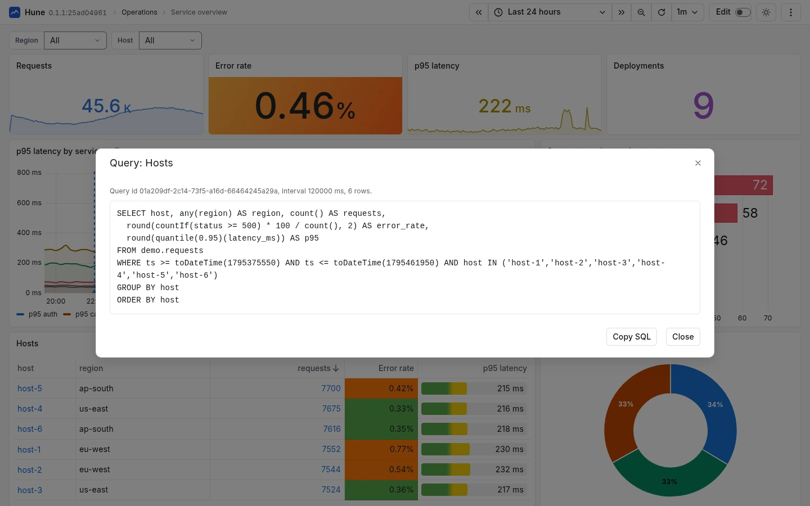 |
| The panel editor, with a live preview. | The inspect view of a panel query. |
| 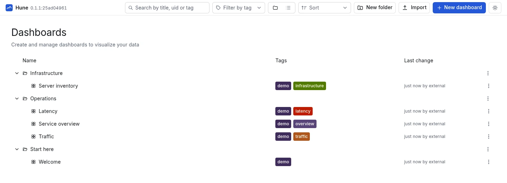 | 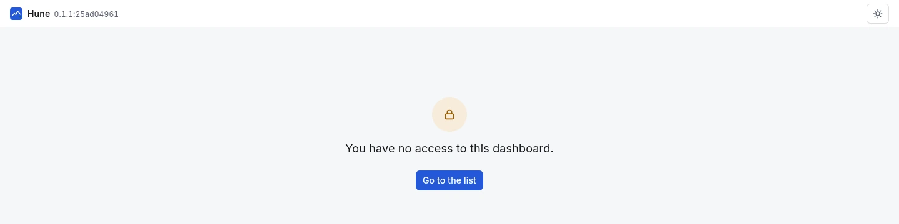 |
| The list of dashboards, with folders. | A dashboard that the PDP refuses. |

The [website](https://procurauth.github.io/hune/) has more pictures. They show the tables, the variables and the time picker, the history of versions, the loader of a panel and the page on a phone. Each picture comes from the product in use, with synthetic data.

## Quick start

This test takes five minutes. It starts a local ClickHouse in Docker, bound to `127.0.0.1`, with synthetic demo data. It pushes no image.

```sh
git clone --depth 1 https://github.com/ProcurAuth/hune.git
docker run -d --rm --name hune-demo-ch -p 127.0.0.1:8123:8123 clickhouse/clickhouse-server:26.8.34.13
sleep 15
docker exec -i hune-demo-ch clickhouse-client --multiquery < hune/examples/demo/init.sql
```

Download Hune and check the archive. The file `SHA256SUMS` lists the checksum.

```sh
curl -fsSLO https://github.com/ProcurAuth/hune/releases/download/v0.3.0/hune_0.3.0_linux_amd64.tar.gz
curl -fsSLO https://github.com/ProcurAuth/hune/releases/download/v0.3.0/SHA256SUMS
sha256sum --check --ignore-missing SHA256SUMS
tar -xzf hune_0.3.0_linux_amd64.tar.gz
mkdir -p /tmp/hune-demo && cp -R hune/examples/demo/dashboards /tmp/hune-demo/dashboards
HUNE_DEMO_CH_PASSWORD=hune-demo-password hune_0.3.0_linux_amd64/hune check-config -c hune/examples/demo/hune.hcl
HUNE_DEMO_CH_PASSWORD=hune-demo-password hune_0.3.0_linux_amd64/hune serve -c hune/examples/demo/hune.hcl
```

Open `http://127.0.0.1:8080/`. Press Ctrl+C to stop Hune, then run `docker stop hune-demo-ch`. The password is a public demo value. [docs/GETTING-STARTED.md](docs/GETTING-STARTED.md) explains each step. To build the binary from the source, read [docs/DEVELOPMENT.md](docs/DEVELOPMENT.md).

## The ProcurAuth family

Hune is a program of the [ProcurAuth](https://github.com/ProcurAuth) organisation. The organisation holds the open specification and the programs that follow it. The [implementations page](https://procurauth.github.io/procurauth/implementations.html) lists them, with the results of the conformance runs.

<p align="center">
  
</p>

| Part | Role | Repository | Site |
| --- | --- | --- | --- |
| **procurauth** | The specification and the reference tools | [ProcurAuth/procurauth](https://github.com/ProcurAuth/procurauth) | [procurauth.github.io/procurauth](https://procurauth.github.io/procurauth/) |
| **portal** | Backend, edge and PDP | [ProcurAuth/portal](https://github.com/ProcurAuth/portal) | [procurauth.github.io/portal](https://procurauth.github.io/portal/) |
| **Stowr** | PEP: a browser for S3, Google Cloud Storage and folders | [ProcurAuth/stowr](https://github.com/ProcurAuth/stowr) | [procurauth.github.io/stowr](https://procurauth.github.io/stowr/) |
| **Hune** | PEP: dashboards over ClickHouse, PostgreSQL and MongoDB | [ProcurAuth/hune](https://github.com/ProcurAuth/hune) | [procurauth.github.io/hune](https://procurauth.github.io/hune/) |
| **ClickHouse Dash** | PEP and MCP server: a query console for ClickHouse | Outside this organisation | [Implementations page](https://procurauth.github.io/procurauth/implementations.html#programs) |

To add a program to this list, open an issue in the [specification repository](https://github.com/ProcurAuth/procurauth/issues).

## Documentation

| Page | Content |
| --- | --- |
| [Getting started](docs/GETTING-STARTED.md) | The five-minute test, step by step. |
| [Configuration](docs/CONFIGURATION.md) and [reference](docs/configuration-reference.md) | The rules, the blocks, the keys. The reference comes from the code. |
| [Architecture](docs/ARCHITECTURE.md) | The server, the query flow, the stores, the sources and the limits. |
| [Access](docs/ACCESS.md) and [conformance](docs/CONFORMANCE.md) | The identity token, the resource tree, the actions, the ceilings, and the test of ProcurAuth. |
| [Security model](docs/SECURITY-MODEL.md) | What Hune protects, and how. |
| [Operations](docs/OPERATIONS.md) | Run, network, health, logs, limits, backup, upgrade and troubleshooting. |
| [Specification](docs/SPECIFICATION.md) | The eight parts: format, API, query engine, page, access, configuration and tests. |
| [Status](docs/implementation-status.md) | What exists, the differences from the specification and the known limits. |
| [Development](docs/DEVELOPMENT.md) | The checks, the tests, the dependencies and the release. |
| [Changelog](CHANGELOG.md) | The changes of each version. |

The same pages are on the [website](https://procurauth.github.io/hune/). The Markdown files are the source.

## Build and test

The CI scripts use Docker. The toolchain is fixed in `rust-toolchain.toml`.

```sh
cargo fmt --all -- --check
cargo clippy --workspace --all-targets --locked -- -D warnings
cargo test -p hune-core --locked
node --test tests/frontend/
python3 -I scripts/check-docs.py
```

The full gate is `tests/ci/all.sh`. It is heavy, and it starts ClickHouse, PostgreSQL and MongoDB. The release path is `tests/ci/all.sh` and `tests/ci/release.sh`. The workflows in `.github/workflows` run the same jobs on GitHub, as an option.

## Security

Do not open a public issue for a vulnerability. Use the [private report](https://github.com/ProcurAuth/hune/security/advisories/new). [SECURITY.md](SECURITY.md) tells the supported versions and the response times. The [security model](docs/SECURITY-MODEL.md) tells what Hune protects.

## Contribute

Read [`CONTRIBUTING.md`](CONTRIBUTING.md). Open an issue with one of the [forms](https://github.com/ProcurAuth/hune/issues/new/choose) to ask a question or to report a defect. This project follows the [code of conduct](CODE_OF_CONDUCT.md).

## Licence

Hune is under the licence `MIT OR Apache-2.0`. You can use it under the terms of either licence. The files [`LICENSE-MIT`](LICENSE-MIT) and [`LICENSE-APACHE`](LICENSE-APACHE) hold the two texts. The third-party files that Hune embeds keep their own licences: see [THIRD-PARTY-NOTICES.md](THIRD-PARTY-NOTICES.md).
