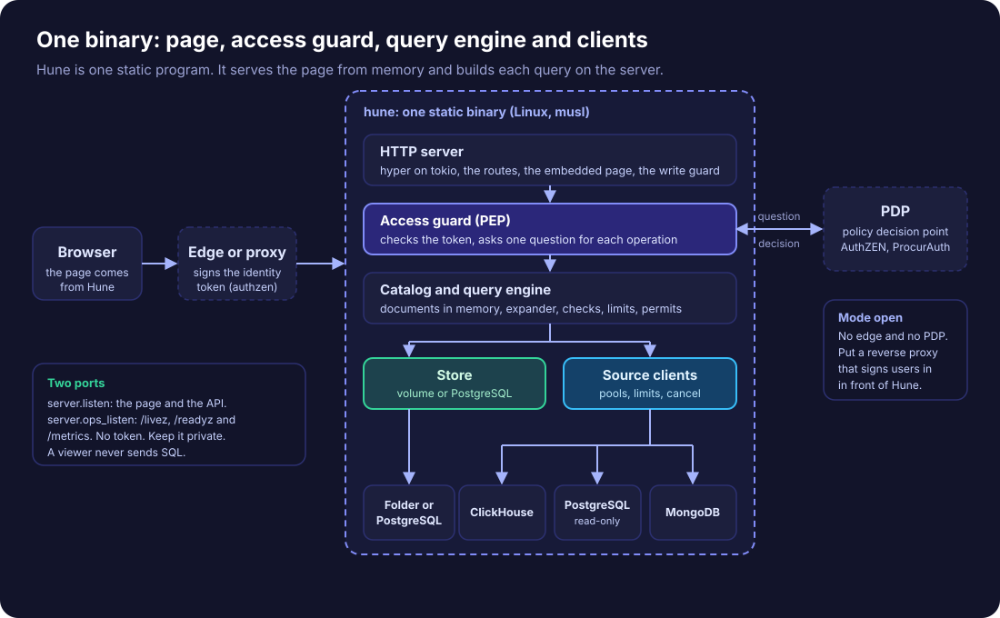
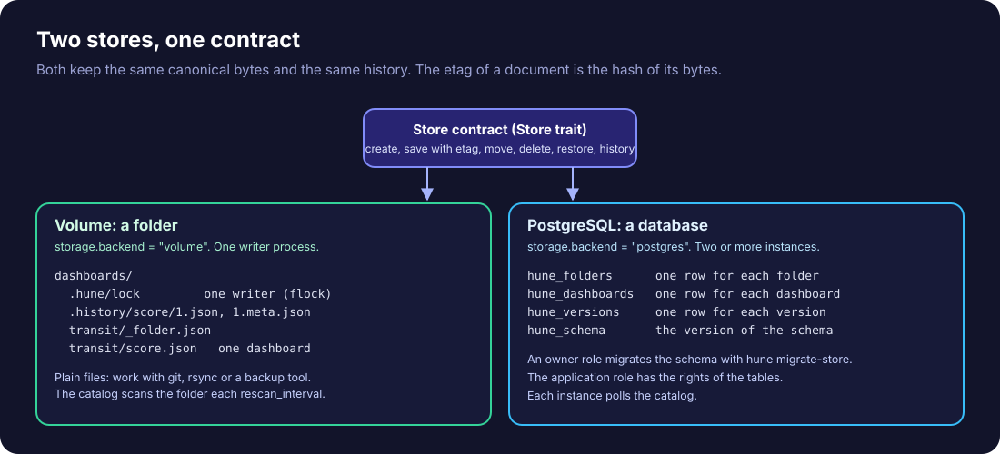
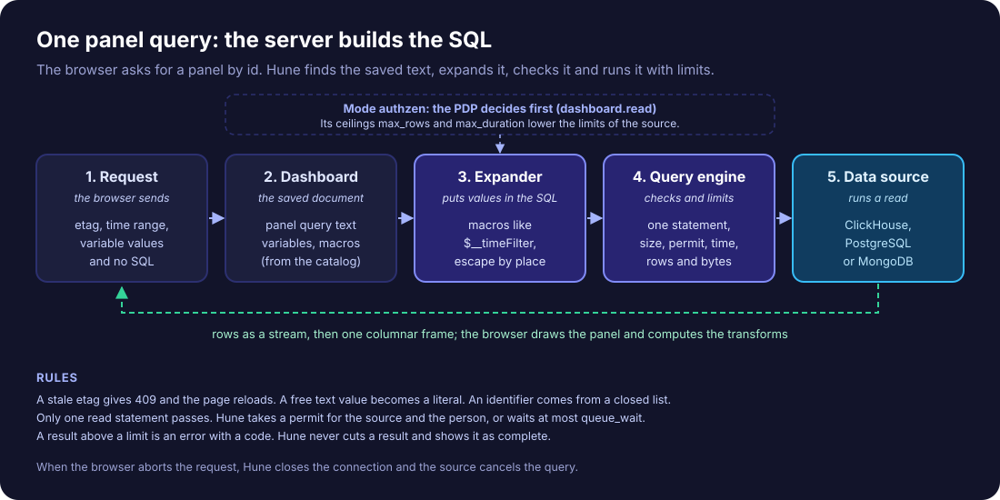

# Architecture

This document tells how Hune works inside. Part 1 of the [specification](SPECIFICATION.md) and the other parts give the full rules. Each section here names the paragraphs that hold them.

## One binary

Hune is one static binary, `hune`. It is built with musl for Linux. The binary holds the HTTP server, the page, the query engine, the two stores, the three source clients and the command line tools. It needs no other file at run time.

The server has two listeners. The main listener serves the page, the static files, the API and the ProcurAuth routes. The ops listener serves `/livez`, `/readyz` and `/metrics` only. The ops listener needs no token and must not be reachable through the edge (3.8).

  

| Part | What it does |
| --- | --- |
| HTTP server | Routes about 30 requests with `hyper`. Serves the embedded page. Applies the write guard and the security headers. |
| Access guard | In the mode `authzen`, it checks the identity token and asks the PDP before each operation. In the mode `open`, it asks nothing. |
| Catalog | Keeps the documents of the store in memory: canonical bytes, parsed document, etag, version and folder. The catalog holds no query result. |
| Query engine | Expands the macros and the variables of the saved SQL, checks the text, applies the limits and asks the source. |
| Store | A volume (a folder) or PostgreSQL. It keeps the documents and their history. |
| Source clients | One client for each kind of source: ClickHouse, PostgreSQL and MongoDB. Each one has a pool, limits and a cancel. |

## The document and the stores

A dashboard is one JSON document of the format 3. The format has a closed schema: an unknown member is an error. The server writes each document in a canonical form with one exact byte sequence. The etag of a document is the hash of these bytes (4.38, 4.39).

The document holds no storage data. The store keeps the folder, the version, the etag and the author.

  

| Store | Key | Layout | Instances |
| --- | --- | --- | --- |
| Volume | A block `storage.volume "<id>"` | One file `<folder>/<uid>.json` for each dashboard. A folder `.history` keeps each version. | One writer process for the primary volume. It holds a lock on the folder. A read-only volume takes no lock. |
| PostgreSQL | The block `storage.postgres` | The tables `hune_folders`, `hune_dashboards`, `hune_versions` and `hune_schema`. | Two or more instances. |

Both stores keep the same canonical bytes and follow the same contract and the same test suite (section 5). Each save writes a history version first, then the document. A save carries the etag of its base, so a stale save gets a conflict and no data is lost. The editor shows a conflict screen. The commands `copy-store`, `export`, `import` and `restore` move documents between stores (5.37 to 5.40).

The catalog reads the store at start and polls it. A change that comes from outside, for example a `git pull` on a volume, shows up at the next poll (5.17, 5.30).

## The query flow

A viewer never sends SQL. The browser sends the dashboard etag, the variable values and the time range. The server finds the saved query in its catalog.

  

1. The server runs the limits, the write guard and the token check. In the mode `authzen`, it asks the PDP for `dashboard.read` and applies the ceilings of the answer.
2. The server compares the etag with the catalog. A stale etag gives `409 dashboard_changed`, and the browser loads the dashboard again.
3. The server checks the time range, `max_data_points` and the variable values (section 7).
4. The expander puts the macros and the values in the stored SQL. It escapes each value by its place in the text. The lexer of the source finds that place.
5. The server checks the statement and the size of the final SQL. It takes a permit of the source, or it waits at most `queue_wait`.
6. The source client sends the text. ClickHouse gets it in the body of an HTTP request. PostgreSQL gets it in one Parse message inside a read-only transaction. MongoDB gets a typed command.
7. The server reads the rows as a stream and builds a columnar frame. The browser draws the panel and computes the transforms.

When the browser aborts a request, the server drops it. The connection closes and the source cancels the query. Hune never cuts a result. A result above a limit is an error with a code.

## Data sources

| Kind | Block | Reads with | Boundary |
| --- | --- | --- | --- |
| ClickHouse | `clickhouse "<id>"` | HTTP, with `max_execution_time`, `max_result_rows` and a `query_id` | The ClickHouse account with the profile `readonly` (12.12). |
| PostgreSQL | `postgres "<id>"` | The wire protocol, one Parse message, a read-only transaction | The role of the source (8a.13). |
| MongoDB | `mongodb "<id>"` | The driver, a closed list of commands and stages | The user of the source (8b.13). |

Each source has limits in the file. They cover the time, the rows, the bytes, the size of a query and the number of queries at the same time. A probe checks the account and the settings at start. These checks are not the security boundary. The account of the source is the boundary.

## The page

The page is plain JavaScript, HTML and CSS. It has no framework and no build step. The binary embeds the files and compresses them one time at start. A test limits the size of the page for the dashboard view. The editor loads on demand. The chart engine is a copy of the engine of ClickHouse Dash, with marked edits (see [chart engine edits](engine-patches.md)).

The page has fifteen panel types, variables, transformations, annotations, a time picker and two colour themes. The editor has a form for each panel type, a query editor with a syntax tree, a history and a conflict screen.

## Access

The mode `open` trusts each request. A reverse proxy must authenticate the people. The mode `authzen` makes Hune a policy enforcement point (PEP) of [ProcurAuth](https://github.com/ProcurAuth/procurauth). The edge signs an identity token. Hune checks it and asks a PDP before each operation. [Access and ProcurAuth](ACCESS.md) has the rules.

## Limits

Each queue, pool and cache has a bound. When a bound is reached, Hune answers at once with a code and `Retry-After`. It never keeps a request in an unbounded queue. Section 12.16 of the specification lists the bounds.

## Code layout

| Crate | Role |
| --- | --- |
| `hune` | The binary: server, access, command line, telemetry. |
| `hune-core` | The format, the validation, the SQL and MongoDB lexers, the expander and the checks. |
| `hune-store` | The `Store` trait, the volume and the PostgreSQL backend. |
| `hune-source` | The three source clients. |
| `hune-grafana` | The importer of Grafana dashboards. |
| `hclconf` | The strict HCL reader and the table of keys. |

The code forbids `unsafe`. Only one file reads the environment (3.4).
